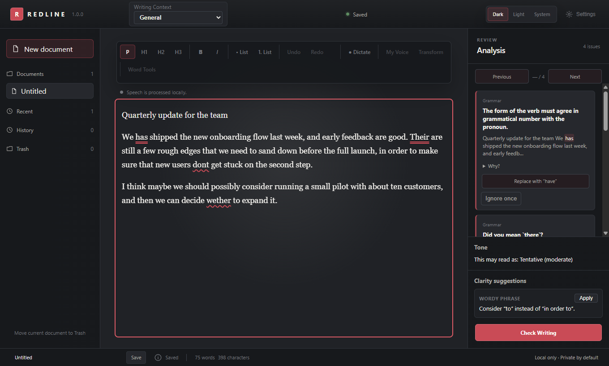
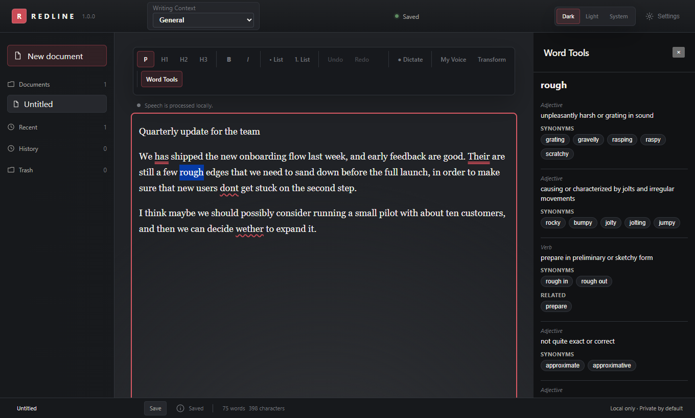
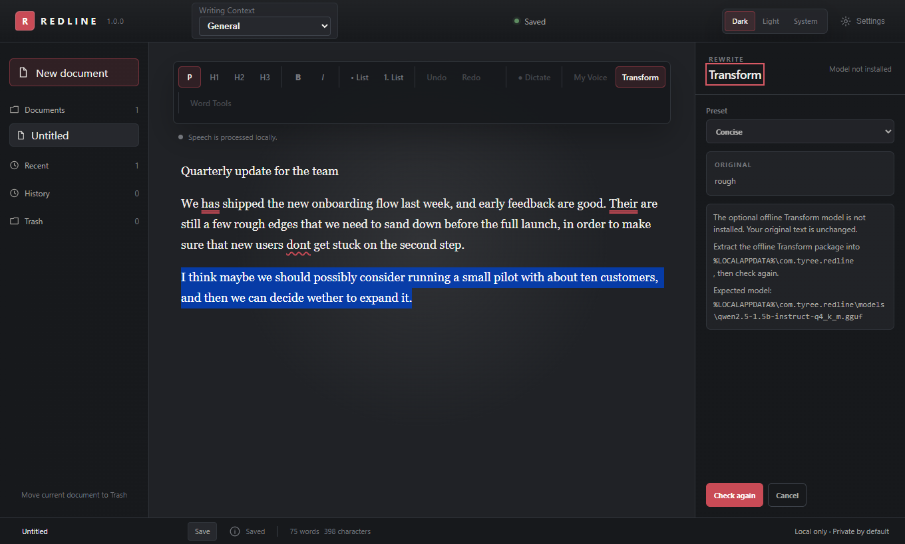

# REDLINE

A local-first writing app for Windows that helps me polish my own writing without rewriting it for me.

I built REDLINE because I wanted a writing tool that stays on my side of the page. It marks grammar, spelling, punctuation and clarity problems, explains them, and lets me accept or ignore each one. Corrections are deterministic and conservative first. The one place a language model comes in is rewrites you explicitly ask for, and those are always shown as a preview before anything changes. Everything runs on the machine, and the app works offline after installation.

> **Work in progress.** The 1.0.0 baseline described below is what this repository's `main` contains. Live (streaming) dictation is still in development on a separate branch and is not part of `main`.

## What it does

- **AXIOM proofreading.** My own proofreading layer over the [Harper](https://github.com/Automattic/harper) grammar engine, with context rules, structural rules and style rules. Protected spans (URLs, code, quoted text, addresses and similar) are left alone, and corrections are mapped back to the text in a Unicode-safe way.
- **Clarity.** Advisory suggestions for wordy phrases, unusually long sentences and repeated sentence openers. They are suggestions, never errors, and are kept separate from grammar corrections.
- **Tone.** A plain advisory read on whether a passage sounds informal, tentative, confident, formal, direct or neutral, with a stated confidence. It is never a score.
- **Writing goals and a personal style guide.** Set the audience and purpose once; add preferred terms and capitalization that REDLINE then suggests with one-click replacement.
- **Word Tools.** A local thesaurus with synonyms and antonyms from Open English WordNet, no network lookups.
- **Transform Studio.** Preview-first local rewrites (including Simplify, Expand and Improve Flow) using an optional offline model of about 1.09 GB. Nothing is applied without a preview, and there is undo.
- **My Voice.** An optional local rewrite mode that uses the same optional offline model package.
- **Dictation.** Record, stop, then transcribe locally with Whisper and insert the text. The microphone is only used after you grant WebView2 permission.
- **Documents.** A rich-text editor (Tiptap) with documents stored in a local SQLite database.

## Screenshots

Real captures of the running desktop app, using a short made-up note I typed in. None of it is my own writing.



| Word Tools | Transform |
| --- | --- |
|  |  |

The Transform shot is honest about its state: the rewrite model is a separate ~1 GB optional download that I didn't install for the capture, so you see the preset list and the "model not installed" message rather than a rewrite. I didn't capture dictation because it needs a live microphone and I didn't want to fake it.

## Built with

Tauri 2, React, TypeScript and Tiptap on the front end, with Rust owning SQLite persistence, local Whisper transcription and local llama.cpp inference for Transform. The React side talks to a small, bounded set of Tauri commands. A tight CSP, command capabilities, input limits and model hashes keep the app inside its local/private boundary.

## Current status

- **Released baseline:** 1.0.0 (`v1.0.0` tag, 2026-09-19). The [CHANGELOG](CHANGELOG.md) has the full version history from 0.1.x.
- **In development, not in `main`:** a 1.1 candidate with live dictation and a UI modernization. Until it passes the release checks in [RELEASE_CHECKLIST.md](RELEASE_CHECKLIST.md), treat live dictation as unfinished.
- **Windows 10/11 x64 only**, with the Microsoft Edge WebView2 Runtime. The installer is unsigned and private-use, so SmartScreen may warn.
- **Known gaps:** Writing Context rendered QA is still a manual follow-up (see the CHANGELOG). `pnpm check` does not pass from a clean clone of `main` right now. When I ran the scripts individually, `test:foundation`, `test:editor`, `test:dictation`, `test:humanizer`, `test:axiom`, `test:terminology`, `test:grammar-corpus` and `test:clarity` passed and `tsc --noEmit` is clean. `test:transform` fails because the check script expects three Transform modes while the source has more, and `test:lexicon` fails because it needs a local Open English WordNet reference dataset (`probes/axiom-reference/oewn`) that isn't in the repository. `biome check` also reports import-ordering and formatting complaints. I haven't fixed any of these yet.
- **Whisper model (downloaded, not in Git):** the bundled dictation model is `ggml-base.en.bin`, OpenAI's Whisper `base.en` converted by whisper.cpp (about 141 MiB, SHA-256 `a03779c86df3323075f5e796cb2ce5029f00ec8869eee3fdfb897afe36c6d002`). Both the model and whisper.cpp are MIT licensed. The file is not stored in this repository; `pnpm fetch:model` downloads it, verifies the hash and puts it in `src-tauri/resources/models/`. See "Run it from source" below.
- **License:** the source is publicly viewable, but I haven't granted an open-source license, so all rights are reserved for now. Third-party components are listed in `src-tauri/resources/THIRD_PARTY_NOTICES.txt`.

## Run it from source

You need Node.js 20.19+ or 22.12+ with Corepack-managed pnpm 11.16.0, a stable Rust MSVC toolchain and the Visual Studio C++ build tools.

```powershell
pnpm install
pnpm fetch:model    # download + verify the Whisper model (needed once)
pnpm dev            # Vite front end only
pnpm tauri dev      # Windows desktop app
pnpm check          # typecheck, Biome, and the project's check scripts
pnpm tauri build    # production NSIS installer
```

**The Whisper model is not in Git.** `pnpm fetch:model` downloads `ggml-base.en.bin` (147,964,211 bytes) to a temporary file, checks its SHA-256 (`a03779c86df3323075f5e796cb2ce5029f00ec8869eee3fdfb897afe36c6d002`), and only then moves it to `src-tauri/resources/models/ggml-base.en.bin`. If a verified copy is already there it does nothing. `pnpm tauri dev` and `pnpm tauri build` run it automatically before the frontend step, but **a direct `cargo test` does not**, so run `pnpm fetch:model` first if you run the Rust tests yourself (they and the Tauri build need the file to exist).

Primary source: the [`model-assets-v1` release](https://github.com/Tyreezebreezy/redline/releases/tag/model-assets-v1) on this repository. Fallback: the [whisper.cpp model repo on Hugging Face](https://huggingface.co/ggerganov/whisper.cpp). To do it by hand, download `ggml-base.en.bin` from either place into `src-tauri/resources/models/` and check that its SHA-256 matches.

The local dictation model ships with the installer. The Transform / My Voice model is a separate optional package (`pnpm package:transform-model`) and Transform stays disabled until its verified model is installed.

There are benchmark corpora for the proofreading engine (`pnpm benchmark:axiom`), dictation, Transform and My Voice, and design notes in [`docs/`](docs).
